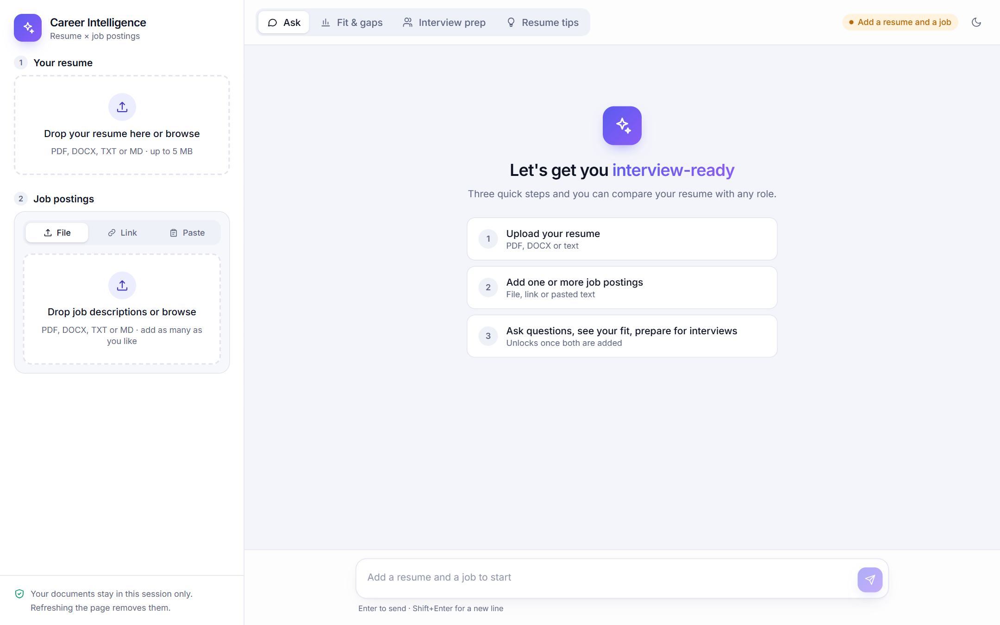
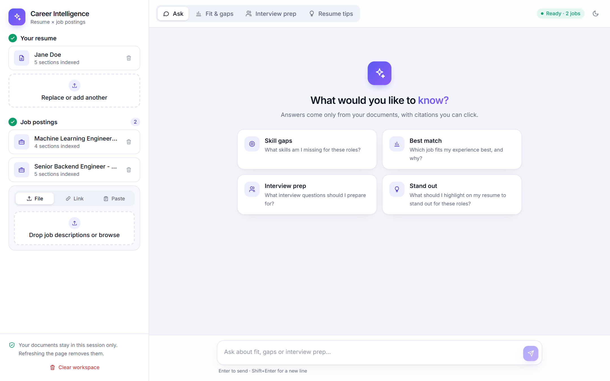
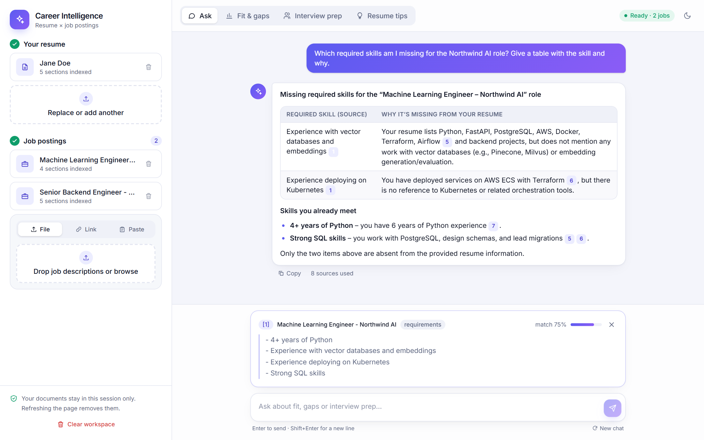
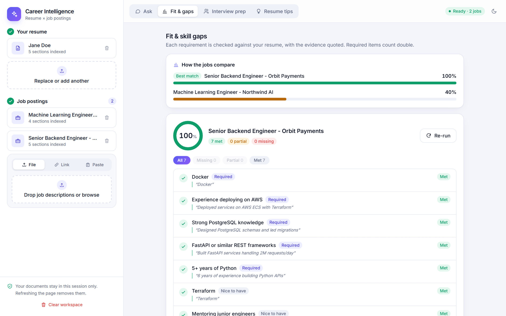
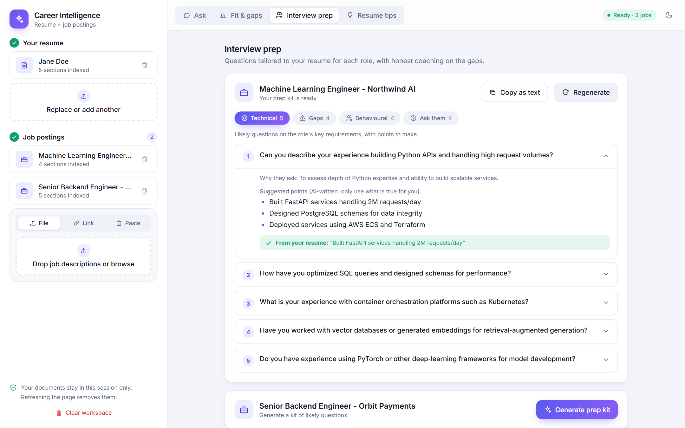
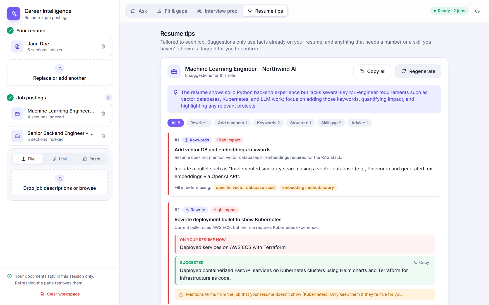
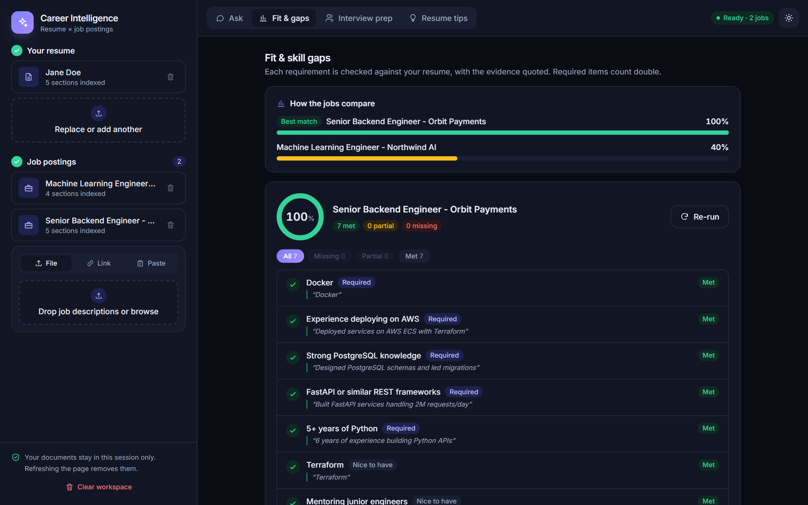
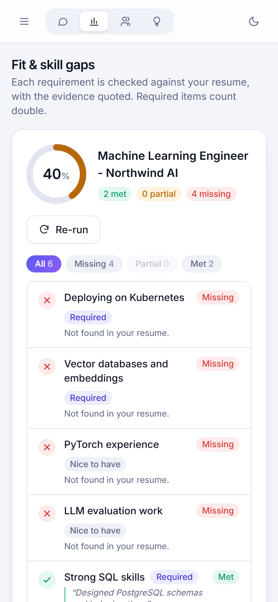
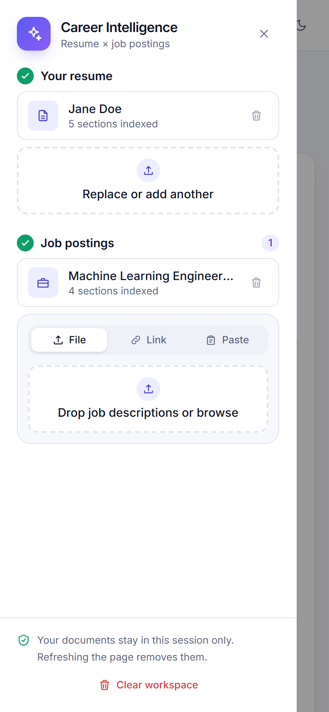
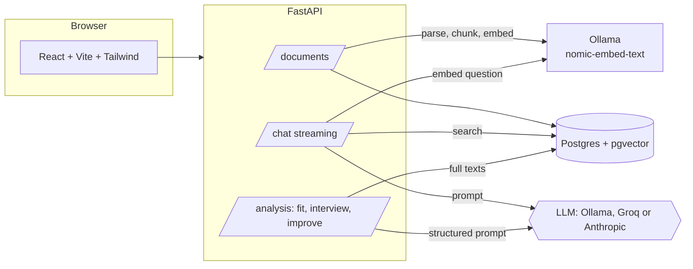

# Career Intelligence Assistant

You upload your resume and a few job postings. Then you can ask questions about how well you fit, see which
skills you're missing, get likely interview questions, and get suggestions for improving your resume. Every
answer comes from your own documents and shows where it came from.

I picked the career option because I'm job hunting myself. Tailoring a resume to every posting, and guessing
which gaps actually matter, is slow and unclear. I wanted something that shows me how I measure up to a role,
with the evidence, and tells me what to fix.

> [!IMPORTANT]
> **This app is not hosted anywhere. Run it locally** (see [Quick setup](#quick-setup)). I looked at hosting it
> (for example the frontend on Vercel) and decided against it, because of these problems:
> - **Ollama can't run on those platforms.** Embeddings use a local Ollama model, so a hosted version needs a
>   hosted embedding provider, which is a code change and means re-embedding every document.
> - **Postgres with pgvector needs a separate hosted database** (Neon, Supabase or RDS). Vercel doesn't host it.
> - **Streaming and long requests.** Chat and the fit, interview and resume analyses stream over SSE and can take
>   a while. Serverless functions have time limits and awkward streaming.
> - **Heavy dependencies.** PDF, DOCX and web-page parsing make a serverless bundle large and slow to start.
> - **No login.** Sessions are a random per-page ID, so a public URL would let anyone upload documents.
>
> The deployment plan for a real cloud is in [Putting it on a cloud](#putting-it-on-a-cloud-aws-example-gcp-and-azure-map-the-same-way).

## Where things are

| What | Where |
|---|---|
| Runbook (run, configure, fix things) | [docs/RUNBOOK.md](docs/RUNBOOK.md) |
| Functionality (how each part works, the API, the database) | [docs/FUNCTIONALITY.md](docs/FUNCTIONALITY.md) |
| Features (every feature, how I checked it, its limits) | [docs/FEATURES.md](docs/FEATURES.md) |
| Tests, coverage numbers and the evaluation set | [docs/TESTING.md](docs/TESTING.md) |
| Screenshots (all taken from my local run) | [docs/screenshots/](docs/screenshots/) |
| Sample resume and job postings | [samples/](samples/) |
| My build notes and AI usage rules | [notes.md](notes.md) |

## Screenshots

All of these were taken from the app running on my machine, with a made-up sample resume and sample job
postings (they're in the repo), not real documents. They follow the steps of using the app.

**Step 1: Start.** The first screen with an empty workspace. Add the resume first, then job postings.



**Step 2: Add documents.** Upload a resume and job postings as files, links or pasted text. Each one shows how
many sections were indexed. Refreshing the page clears them.



**Step 3: Ask questions.** A cited answer with a table. Clicking a citation chip shows the exact passage used.



**Step 4: Fit & skill gaps.** A score per job, a ranking, and every requirement with the resume line that
proves it.



**Step 5: Interview prep.** Likely questions for each job, with the evidence from my resume.



**Step 6: Resume tips.** A before and after rewrite, with a warning when a suggestion mentions something the
resume doesn't show (here, Kubernetes).



<details>
<summary>Also: dark mode and phone layout</summary>

| Dark mode | Phone: fit view | Phone: menu |
|---|---|---|
|  |  |  |

</details>

## What it does

- **Add documents** as a file (PDF, DOCX, text), a link to a public job page, or pasted text.
- **Ask questions** in chat. Answers stream in with clickable citations that show the exact passage used. If the
  documents can't answer, it says so instead of guessing.
- **Fit & gaps:** a score for each job, with every requirement marked met, partial or missing and the resume
  line that proves it.
- **Interview prep:** technical, gap, behavioural and "questions to ask" for each job, based on my resume.
- **Resume tips:** rewrites and fixes for a specific job, with warnings when a suggestion might invent something.
- Dark mode, drag and drop, and a phone layout.

## Quick setup

You need Docker Desktop and [Ollama](https://ollama.com) running on your machine. Ollama makes the embeddings
(it's also the default chat model). A Groq or Anthropic key is optional but makes the slow parts much faster.

```bash
cp .env.example .env              # pick an LLM provider and add a key if you use a hosted one
ollama pull nomic-embed-text      # embeddings (always needed)
ollama pull llama3.1              # only if LLM_PROVIDER=ollama
docker compose up --build
```

| What | Where |
|---|---|
| App | http://localhost:8090 |
| API docs | http://localhost:8091/docs |
| Database | `localhost:5435` (user, password and db are all `app` / `app` / `career`) |

Sample files are in [`samples/`](samples/). Running without Docker, the config options and troubleshooting are in
the [Runbook](docs/RUNBOOK.md).

## How it's put together



Three flows matter:

1. **Adding a document.** I read the file, split it by its headings (Experience, Requirements and so on), turn
   each piece into a vector and store it in Postgres.
2. **Chat.** I embed the question, look up the best matching pieces from the resume and from the jobs, and
   refuse to answer if nothing matches well enough. Otherwise the model answers using only those pieces and
   cites them.
3. **Fit, interview prep and resume tips.** Each sends the whole resume and the whole job to the model and asks
   for structured JSON. I check the JSON, verify the quotes against the resume, and cache the result.

```
backend/app/      the API: routes/, ingest/, chat.py, analysis.py, interview.py, suggestions.py, llm.py
backend/evals/    the evaluation set and runner (python -m evals.run)
backend/tests/    155 tests
frontend/src/     the React app
docs/             runbook, functionality, features, testing
samples/          example resume and job postings
```

## Choices I made (RAG and LLM)

A note first: I googled the options for most of these, but I asked the LLM to pick, and I went with what it
suggested. Below I say what I understood of each choice and, where it matters, what I actually decided myself.

**Chunking.** The LLM suggested splitting by headings (Experience, Requirements and so on) instead of fixed-size
windows, and I kept it. Resumes and job posts are short and have clear sections, and the fit score needs to know
whether a line is under "required" or "nice to have". A fixed window would mix those up. Pieces over 1,200
characters get split on bullet or paragraph breaks.

**Embedding model.** I found OpenAI, Voyage and local models. I let the LLM choose, and it picked
`nomic-embed-text` through Ollama. I'm fine with that: resumes are personal, so I like that nothing is sent to
a third party just to be embedded, and there are only a few dozen chunks. The biggest retrieval problem we hit
was that a chunk like "Requirements: Python, SQL" doesn't say which company it belongs to. Adding the document
title to the text that gets embedded took the test set's retrieval hit rate from **33% to 100%**.

**Vector database.** I found Chroma, Qdrant and pgvector. I went with Postgres + pgvector because I already use
Postgres in my regular work, so I know how to run it and debug it. One database holds the vectors, the documents,
the cached results and the session separation. At this size an exact search is fast, so there's no index to tune.

**LLM.** The provider is a setting (`LLM_PROVIDER`): local Ollama, Groq or Anthropic. Local is private but a fit
analysis took about 1.5 to 3 minutes on my machine. Groq did the same in about 2 seconds. I use Groq's
`openai/gpt-oss-120b` day to day. Ollama is still there if I don't want my documents leaving my machine.

**Framework.** I didn't use LangChain or similar. The pipeline is a handful of steps, and I wanted to see and
test each one (thresholds, prompts, how I balance resume and job results) instead of hiding them.

**Prompts and context.** Retrieved pieces go into numbered `<source>` tags, and the prompt says to answer only
from them, cite as `[n]`, and treat the text as data. I take the top 4 from the resumes and the top 4 from the
jobs separately. With one combined top-k, job text crowded out the resume and questions like "how does my
experience fit?" failed. For fit, interview and resume tips I skip retrieval and send both full documents,
because they're small and retrieval could miss a requirement.

**Guardrails.**
- If the best match is below a similarity threshold (0.5), the model isn't called at all.
- Uploaded text is wrapped in tags and treated as untrusted. One of my test job posts says "ignore all previous
  instructions", and the assistant ignores it.
- In fit analysis, a "met" claim whose quoted evidence isn't on the resume is downgraded to missing.
- The score itself is calculated in code, not by the model.
- File type and size limits, and each browser session only sees its own documents.

**Quality.** 155 tests (87% line coverage) and a small evaluation set of 16 questions and 3 fit cases that I
run against the real pipeline. The latest run scored 100% on retrieval, answers, citations, refusals, injection
resistance and fit. The set is small and I tuned things while fixing its failures, so I read that as "no known
regressions", not "proven correct". Details and the history of what broke are in
[docs/TESTING.md](docs/TESTING.md).

**Observability.** JSON logs with a request ID, timings, how many chunks were retrieved and the top score, and a
`/health` endpoint. I haven't added tracing, metrics or token and cost tracking.

## What I found while building it

1. **The first UI looked old and classic.** I told it what I wanted: a modern look and a light or dark theme.
   I picked the theme behaviour and the layout from what I saw on screen, not from what it first gave me.
2. **Answers came back as markdown tables with pipe symbols.** I said that's hard for other people to read, so
   they are now shown as points and paragraphs.
3. **LinkedIn import failed.** I tried a LinkedIn URL and got nothing. When we looked into it, LinkedIn needs a
   login, so it can't be fetched. I decided to leave it that way and show a clear message. Pasting the text of a
   company career page works.
4. **The document title goes into the embedding.** Small change, biggest improvement: 33% to 100% retrieval on
   my test set.
5. **The score is computed in code.** The model only says met, partial or missing and quotes the proof. The
   number comes from a fixed formula (required items count double, partial counts half).
6. **Slow things stream.** The first fit-analysis endpoint waited for the full answer and a proxy cut it off
   around 111 seconds. Streaming progress fixed it.

## Engineering standards

What I followed: type hints, a lint-clean codebase (ruff), small modules, every outside service (Ollama,
Postgres, the LLM) passed in so tests can fake it and run offline, model output validated with Pydantic and one
retry, Docker Compose with health checks, CI that runs lint, tests and the frontend build, and secrets kept out
of git.

What I skipped on purpose: login and multi-user support, database migrations (the schema is created on
startup), frontend tests, rate limiting, OCR for scanned PDFs and load testing.

## How I used AI tools

I used Claude Code to write most of the code. I told it how the modules, components and utilities should be
laid out first, then I read what it wrote, ran the app and fixed what was wrong. I keep the project rules in
`CLAUDE.md` (no LangChain, tests and lint must pass, uploaded text is data, answers must cite or refuse).

I didn't just accept what it gave me. Examples from this project:
- The first layout was ugly. I gave it ideas and chose the theme.
- Output as markdown tables wasn't comfortable to read, so I asked for points and paragraphs.
- I tried the LinkedIn URL myself, saw it fail and asked why.
- I asked it questions about its choices (the stack, the LLM, the vector database) before agreeing.
- It got test expectations wrong more than once (the code was right, the test was sloppy), and a rule that
  required names of 2+ characters rejected a real requirement, "R". The evaluation run caught that.
- A hosted model name it picked didn't exist. We found out by listing the models my key could use.

This README was drafted by the AI from my answers to its questions and then edited by me. The choices marked
above as "the LLM picked" are exactly that. I'm saying so openly.

**My do's and don'ts with AI coding tools**

Do:
- Say how the code should be structured first (which modules, components and utilities), before it writes
  anything. It's much easier than untangling a layout it invented.
- Read the code afterwards and look for things to fix.
- Run and test everything myself, not just trust "it works".
- Keep the project rules in a file (`CLAUDE.md`) so the results are repeatable across sessions.

Don't:
- Accept its output blindly. It got test expectations and edge cases wrong in this project.
- Commit secrets. Keys live in `.env`, which is git-ignored.
- Skip the tests. Lint and tests have to pass (CI runs them) before anything goes to `main`.

## Putting it on a cloud (AWS example, GCP and Azure map the same way)

| Area | Today | In production |
|---|---|---|
| Compute | Docker Compose | API on ECS Fargate or Cloud Run behind a load balancer; frontend as static files on S3 + CloudFront |
| Database | One Postgres container | Aurora or RDS Postgres with pgvector, Multi-AZ, backups; add an HNSW index once there are 100k+ chunks |
| Slow jobs | Run inside the request | Upload to S3, queue with SQS, workers scale on queue depth, the UI polls or streams status |
| LLM | Local Ollama or a Groq/Anthropic key | Bedrock or a provider with an enterprise data agreement; per-user quotas; a circuit breaker (429 backoff exists already) |
| Embeddings | Local Ollama | Bedrock Titan or a hosted embedding endpoint |
| Auth | A random per-page session ID | Cognito or OIDC login, a tenant ID on every table, row-level security |
| Secrets | `.env` file | Secrets Manager, rotated keys |
| Monitoring | JSON logs | OpenTelemetry traces and metrics, prompt and cost tracking (Langfuse or similar), alerts on errors, latency and 429s |
| Security | Basic limits | WAF and rate limiting, virus scanning of uploads, encryption at rest, a retention and deletion policy |
| Delivery | CI for lint, tests, build | Image scanning, Terraform, blue/green deploys, Alembic migrations, the eval run as a release gate |
| Scaling | One process | Stateless API that scales horizontally; cache embeddings by content hash |

## What I'd do with more time

- **Hybrid search and a reranker.** This is my first pick. I read in ChatGPT and Claude that combining
  keyword search (Postgres full-text) with vector search, then reranking, gives the best results, so I want to
  try it and measure it on my evaluation set instead of taking their word for it. Exact skill names like
  "Terraform" or "R" are where I'd expect it to help.
- **Auth, a job queue and a real cloud deployment** instead of running everything in the request.
- **Frontend tests and monitoring:** automated UI tests (Vitest, Playwright), tracing, metrics, and token and cost
  tracking.
- Smaller things I'd also like: add interview prep, resume tips and URL import to the evaluation set, and
  check or drop the AI-written talking points in the interview kit.

## Known limitations

- Scanned (image-only) PDFs can't be read. There's no OCR.
- Job links: LinkedIn, Indeed and Glassdoor block automated access and need a login, so the app says so and
  suggests Paste. Other sites that need JavaScript can fail the same way.
- Everything is wiped when you refresh. Documents live in a per-page session on purpose (I'd rather lose data
  than keep resumes around). Documents older than 24 hours are also deleted when the API starts.
- The evaluation set is small and I tuned it while fixing failures, and its scoring is keyword-based.
- Resume-tip checks are regex and word based, so a made-up detail with no number, skill name or result word can
  slip through. Read every rewrite before using it.
- Documents uploaded before I added the title to the embeddings keep the old vectors; re-upload them.
- There's no login. The latest uploaded resume is the one analysed.
- Local models are slow (minutes), and hosted ones send your text to the provider. Free hosted tiers rate-limit
  (Groq's was 8,000 tokens a minute).
- The frontend has no automated tests.
