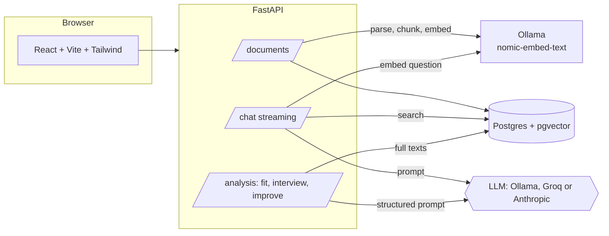

# Career Intelligence Assistant

You upload your resume and a few job postings. Then you can ask questions about how well you fit, see which
skills you're missing, get likely interview questions, and get suggestions for improving your resume. Every
answer comes from your own documents and shows where it came from.

I picked the career option because it's a problem I actually run into: comparing a resume against several job
descriptions and figuring out where you fall short.
<!-- Add a sentence or two of your own here about why this matters to you personally. -->

**More docs**

| Doc | What's in it |
|---|---|
| [docs/RUNBOOK.md](docs/RUNBOOK.md) | How to run, configure and fix things |
| [docs/FUNCTIONALITY.md](docs/FUNCTIONALITY.md) | How each part works, the API, the database |
| [docs/FEATURES.md](docs/FEATURES.md) | Every feature, how I checked it, and its limits |
| [docs/TESTING.md](docs/TESTING.md) | Tests, coverage numbers and the evaluation set |

## Screenshots

<!-- Add screenshots here (sidebar + chat, Fit & gaps, Interview prep, Resume tips, dark mode).
     A folder like docs/screenshots/ works well. -->

## What it does

- **Add documents** as a file (PDF, DOCX, text), a link to a public job page, or pasted text.
- **Ask questions** in chat. Answers stream in with clickable citations that show the exact passage used. If the
  documents can't answer, it says so instead of guessing.
- **Fit & gaps:** a score for each job, with every requirement marked met, partial or missing and the resume
  line that proves it.
- **Interview prep:** technical, gap, behavioural and "questions to ask" for each job, based on my resume.
- **Resume tips:** rewrites and fixes for a specific job, with warnings when a suggestion might invent something.
- Dark mode, drag and drop, and a phone layout.

## Quick setup

You need Docker Desktop and [Ollama](https://ollama.com) running on your machine. Ollama makes the embeddings
(it's also the default chat model). A Groq or Anthropic key is optional but makes the slow parts much faster.

```bash
cp .env.example .env              # pick an LLM provider and add a key if you use a hosted one
ollama pull nomic-embed-text      # embeddings (always needed)
ollama pull llama3.1              # only if LLM_PROVIDER=ollama
docker compose up --build
```

| What | Where |
|---|---|
| App | http://localhost:8090 |
| API docs | http://localhost:8091/docs |
| Database | `localhost:5435` (user, password and db are all `app` / `app` / `career`) |

Sample files are in [`samples/`](samples/). Running without Docker, the config options and troubleshooting are in
the [Runbook](docs/RUNBOOK.md).

## How it's put together



Three flows matter:

1. **Adding a document.** I read the file, split it by its headings (Experience, Requirements and so on), turn
   each piece into a vector and store it in Postgres.
2. **Chat.** I embed the question, look up the best matching pieces from the resume and from the jobs, and
   refuse to answer if nothing matches well enough. Otherwise the model answers using only those pieces and
   cites them.
3. **Fit, interview prep and resume tips.** Each sends the whole resume and the whole job to the model and asks
   for structured JSON. I check the JSON, verify the quotes against the resume, and cache the result.

```
backend/app/      the API: routes/, ingest/, chat.py, analysis.py, interview.py, suggestions.py, llm.py
backend/evals/    the evaluation set and runner (python -m evals.run)
backend/tests/    155 tests
frontend/src/     the React app
docs/             runbook, functionality, features, testing
samples/          example resume and job postings
```

## Choices I made (RAG and LLM)

For each one I list what I looked at, what I picked and why. A lot of these came out of using the app and
fixing what broke, which I note where it applies.

**Chunking.** I looked at fixed-size windows and at splitting by structure. I split by headings and kept the
heading as a label. Resumes and job posts are short and well structured, and the fit score needs to know
whether something is a "required" or a "nice to have" item. A fixed window would blur that. Pieces over 1,200
characters get split on bullet or paragraph breaks.

**Embedding model.** I looked at OpenAI, Voyage and local models. I use `nomic-embed-text` through Ollama.
Resumes are personal, so I didn't want them sent to a third party just to be embedded, and there are only a few
dozen chunks, so a small local model is fine. The biggest retrieval problem I hit was that a chunk like
"Requirements: Python, SQL" doesn't say which company it belongs to. Adding the document title to the text I
embed took my test set's retrieval hit rate from **33% to 100%**.

**Vector database.** I looked at Chroma, Qdrant and pgvector, and went with Postgres + pgvector. One database
holds the vectors, the documents, the cached results and the session separation. It also maps straight onto
RDS or Cloud SQL later. At this size an exact search is fast, so there's no index to tune.

**LLM.** I looked at local Ollama, Anthropic and Groq. The provider is a setting (`LLM_PROVIDER`), so it's easy
to switch. Local is private but a fit analysis took about 1.5 to 3 minutes on my machine. Groq did the same
job in about 2 seconds. I use Groq's `openai/gpt-oss-120b` day to day and keep Ollama as the private option.

**Framework.** I didn't use LangChain or similar. The pipeline is a handful of steps, and I wanted to see and
test each one (thresholds, prompts, how I balance resume and job results) instead of hiding them.

**Prompts and context.** Retrieved pieces go into numbered `<source>` tags, and the prompt says to answer only
from them, cite as `[n]`, and treat the text as data. I take the top 4 from the resumes and the top 4 from the
jobs separately. With one combined top-k, job text crowded out the resume and questions like "how does my
experience fit?" failed. For fit, interview and resume tips I skip retrieval and send both full documents,
because they're small and retrieval could miss a requirement.

**Guardrails.**
- If the best match is below a similarity threshold (0.5), the model isn't called at all.
- Uploaded text is wrapped in tags and treated as untrusted. One of my test job posts says "ignore all previous
  instructions", and the assistant ignores it.
- In fit analysis, a "met" claim whose quoted evidence isn't on the resume is downgraded to missing.
- The score itself is calculated in code, not by the model.
- File type and size limits, and each browser session only sees its own documents.

**Quality.** 155 tests (87% line coverage) and a small evaluation set of 16 questions and 3 fit cases that I
run against the real pipeline. The latest run scored 100% on retrieval, answers, citations, refusals, injection
resistance and fit. The set is small and I tuned things while fixing its failures, so I read that as "no known
regressions", not "proven correct". Details and the history of what broke are in
[docs/TESTING.md](docs/TESTING.md).

**Observability.** JSON logs with a request ID, timings, how many chunks were retrieved and the top score, and a
`/health` endpoint. I haven't added tracing, metrics or token and cost tracking.

## What I'd point out as decisions or lessons

1. **The document title goes into the embedding.** Small change, biggest improvement: 33% to 100% retrieval on
   my test set.
2. **The score is computed in code.** The model decides whether each requirement is met, partial or missing and
   quotes the proof. The number comes from a fixed formula (required items count double, partial counts half).
   That makes it explainable and it can't be invented.
3. **Resume tips are checked, not trusted.** A tool that rewrites your resume is tempting to let make things
   up. I check each suggestion in code: the original line has to exist, new numbers have to be placeholders
   like `[X%]`, skills from the job that aren't on the resume get flagged, and so do invented results like
   "zero downtime". My first version only checked numbers and missed "zero downtime" and "sub-second latency",
   which I only noticed by reading real output. The checks are heuristics and still can't catch everything.
4. **Local or hosted LLM is a trade-off, not a rule.** Local keeps documents on my machine but is slow. Hosted
   is fast but the resume and job text go to that provider. Embeddings stay local either way.
5. **Slow things stream.** My first fit-analysis endpoint waited for the whole answer and a proxy cut it off
   around 111 seconds. Streaming progress events fixed that and let the UI show a live counter.

## Engineering standards

What I followed: type hints, a lint-clean codebase (ruff), small modules, every outside service (Ollama,
Postgres, the LLM) passed in so tests can fake it and run offline, model output validated with Pydantic and one
retry, Docker Compose with health checks, CI that runs lint, tests and the frontend build, and secrets kept out
of git.

What I skipped on purpose: login and multi-user support, database migrations (the schema is created on
startup), frontend tests, rate limiting, OCR for scanned PDFs and load testing.

## How I used AI tools

I used Claude Code to write most of the code. My part was giving instructions on how the modules, components
and utilities should be laid out, then reading the code once it was written to find anything that needed
fixing, and testing it by running the app. I also keep the project rules in `CLAUDE.md` (no LangChain, tests
and lint must pass, uploaded text is data, answers must cite or refuse).

It needed checking. Real examples from this project:
- It got test expectations wrong more than once (the code was right, the test was sloppy).
- A rule that required requirement names to be at least 2 characters rejected a real one, "R". The evaluation
  run caught it, not a code review.
- My first fit-analysis design blocked for minutes and failed behind a proxy.
- A hosted model name it picked no longer existed. I only found out by listing the models my key could use.
- The resume-tips checks missed invented results that had no numbers in them (see above).

I also used AI to help draft this README from my notes and answers, then edited it. The decisions and the
project's mistakes are real and came from building this.
<!-- Add your own do's and don'ts for AI coding tools here: they're graded, and yours matter more than mine. -->

## Putting it on a cloud (AWS example, GCP and Azure map the same way)

| Area | Today | In production |
|---|---|---|
| Compute | Docker Compose | API on ECS Fargate or Cloud Run behind a load balancer; frontend as static files on S3 + CloudFront |
| Database | One Postgres container | Aurora or RDS Postgres with pgvector, Multi-AZ, backups; add an HNSW index once there are 100k+ chunks |
| Slow jobs | Run inside the request | Upload to S3, queue with SQS, workers scale on queue depth, the UI polls or streams status |
| LLM | Local Ollama or a Groq/Anthropic key | Bedrock or a provider with an enterprise data agreement; per-user quotas; a circuit breaker (429 backoff exists already) |
| Embeddings | Local Ollama | Bedrock Titan or a hosted embedding endpoint |
| Auth | A random per-page session ID | Cognito or OIDC login, a tenant ID on every table, row-level security |
| Secrets | `.env` file | Secrets Manager, rotated keys |
| Monitoring | JSON logs | OpenTelemetry traces and metrics, prompt and cost tracking (Langfuse or similar), alerts on errors, latency and 429s |
| Security | Basic limits | WAF and rate limiting, virus scanning of uploads, encryption at rest, a retention and deletion policy |
| Delivery | CI for lint, tests, build | Image scanning, Terraform, blue/green deploys, Alembic migrations, the eval run as a release gate |
| Scaling | One process | Stateless API that scales horizontally; cache embeddings by content hash |

## What I'd do with more time

- **Hybrid search and a reranker.** Combine keyword (Postgres full-text) and vector search, then rerank.
- **Auth, a job queue and a real cloud deployment** instead of running everything in the request.
- **Frontend tests and monitoring:** automated UI tests (Vitest, Playwright), tracing, metrics, and token and cost
  tracking.
- Smaller things I'd also like: add interview prep, resume tips and URL import to the evaluation set, and
  check or drop the AI-written talking points in the interview kit.

## Known limitations

- Scanned (image-only) PDFs can't be read. There's no OCR.
- Job links: LinkedIn, Indeed and Glassdoor block automated access and need a login, so the app says so and
  suggests Paste. Other sites that need JavaScript can fail the same way.
- Everything is wiped when you refresh. Documents live in a per-page session on purpose (I'd rather lose data
  than keep resumes around). Documents older than 24 hours are also deleted when the API starts.
- The evaluation set is small and I tuned it while fixing failures, and its scoring is keyword-based.
- Resume-tip checks are regex and word based, so a made-up detail with no number, skill name or result word can
  slip through. Read every rewrite before using it.
- Documents uploaded before I added the title to the embeddings keep the old vectors; re-upload them.
- There's no login. The latest uploaded resume is the one analysed.
- Local models are slow (minutes), and hosted ones send your text to the provider. Free hosted tiers rate-limit
  (Groq's was 8,000 tokens a minute).
- The frontend has no automated tests.
